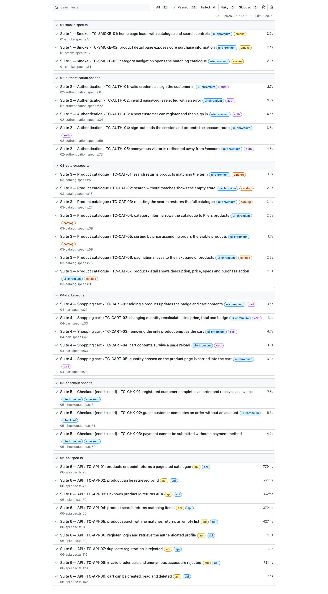

# SIS 2 — Playwright test automation

Automated functional and API tests for the public **[Practice Software Testing — Toolshop](https://practicesoftwaretesting.com/)** demo application, built with **Playwright + TypeScript** for the SIS 2 assignment.

**Public repository:** https://github.com/TheJustRusik/sis2-playwright-toolshop

## Result

| Projects | Suites | Test cases | Result | Duration |
| --- | --- | --- | --- | --- |
| `ui-chromium`, `api` | 6 | 32 | **32 passed, 0 failed** | 28.9 s |



## Test suites

| # | Suite | File | Tests | Tag |
| --- | --- | --- | --- | --- |
| 1 | Smoke | `tests/01-smoke.spec.ts` | 3 | `@smoke` |
| 2 | Authentication | `tests/02-authentication.spec.ts` | 5 | `@auth` |
| 3 | Product catalogue | `tests/03-catalog.spec.ts` | 7 | `@catalog` |
| 4 | Shopping cart | `tests/04-cart.spec.ts` | 5 | `@cart` |
| 5 | Checkout (end-to-end) | `tests/05-checkout.spec.ts` | 3 | `@checkout` |
| 6 | API | `tests/06-api.spec.ts` | 9 | `@api` |

The complete test-case list, steps and expected results are in **[TestCases.md](./TestCases.md)**.

## Quick start

Requirements: Node.js 18+ and npm. The project was verified with Node 26 and Playwright 1.64.1.

```bash
npm install
npx playwright install chromium
npm test
npm run report
```

If the browser download is blocked (for example, behind a campus proxy) but Google Chrome is installed:

```bash
PLAYWRIGHT_CHANNEL=chrome npm test
```

### Run one suite

```bash
npm run test:smoke
npm run test:auth
npm run test:catalog
npm run test:cart
npm run test:checkout
npm run test:api
```

### Run one test case

```bash
npx playwright test -g "TC-CHK-01"
```

## CI

[](https://github.com/TheJustRusik/sis2-playwright-toolshop/actions/workflows/playwright.yml)

**CI system:** GitHub Actions. The repository is already on GitHub, public repos get free runner minutes, there is no separate CI server to maintain, and `strategy.matrix` handles sharding out of the box.

**Pipeline** (`.github/workflows/playwright.yml`):
- triggers on every `push` and `pull_request` (no branch filter), plus `workflow_dispatch` for manual runs;
- installs dependencies with `npm ci` (using `setup-node` `cache: npm`) and installs Chromium with `npx playwright install --with-deps chromium`;
- starts the Toolshop app locally inside the runner via `docker-compose.ci.yml` (`http://localhost:4200` and `http://localhost:8091`), because requests from GitHub Actions IPs hit a Cloudflare bot verification page on `practicesoftwaretesting.com`;
- runs the full Playwright suite in 4 parallel shards (`--shard=i/4`, no test filters);
- merges shard blobs in the `merge-reports` job using `merge.config.ts` into one HTML report and one JUnit XML file;
- uploads `playwright-report`, `test-results-1`..`4` (traces, screenshots, videos, per-shard JUnit) and `junit-report`, kept for 14 days.

**CI config** (`playwright.config.ts`, enabled when `CI` is set): `forbidOnly: true`, `retries: 2`, `workers: 2`, `list` + `blob` + `junit` (`reports/junit.xml`) reporters, and `trace: 'on-first-retry'`.

### Runtime

| Configuration | Total run time | Run tests step (slowest shard) | Run |
| --- | --- | --- | --- |
| 1 job, no sharding | 1 min 47 s | 24 s | [run](https://github.com/TheJustRusik/sis2-playwright-toolshop/actions/runs/45055085135) |
| 4 shards + merge | 1 min 56 s | 13 s | [run](https://github.com/TheJustRusik/sis2-playwright-toolshop/actions/runs/45053161000) |

Numbers are the median of 3 manual `workflow_dispatch` runs each. Splitting across 4 shards cut the test execution step almost in half (24 s to 13 s), though total workflow time was 9 s longer because each shard spends about a minute on setup and starting the Docker containers, plus ~15 s for `merge-reports`. Sharding will save real wall-clock time as the suite grows past a few minutes.

### Running in CI mode locally

```bash
npm ci
npx playwright install --with-deps chromium
CI=true npx playwright test
```

## What is covered

- **Smoke:** home catalogue, product details, category navigation.
- **Authentication:** registration, valid/invalid login, logout, protected `/account`.
- **Catalogue:** search, empty state, reset, category filter, price sorting, pagination, product data.
- **Cart:** add, badge, quantity recalculation, removal, reload persistence, product-page quantity.
- **Checkout:** registered and guest purchases with Cash on Delivery, invoice creation, invoice listing, payment-method guard.
- **API:** paginated products, product by id, 404, search, empty search, register/login/profile, duplicate registration, 401s, cart lifecycle.

## Design

- **Page Object Model** in `src/pages/` — tests express intent, selectors live in page objects.
- **Fixtures** in `src/fixtures/test.ts` — page objects plus a lazy per-test `testUser`.
- **Disposable users** in `src/api/users.ts` — registered through the public API. The documented shared demo account is currently locked (“too many failed attempts”), so tests never depend on it.
- **Stable selectors** — the app's `data-test` hooks (configured as Playwright's `testIdAttribute`), accessible roles where no hook exists, and only two deliberately scoped CSS selectors.
- **Web-first assertions** — no fixed sleeps in tests; `expect.poll` is used for collection-level properties and asynchronous address lookup.
- **Two Playwright projects** — UI (`ui-chromium`) and API (`api`, running in seconds).
- **Evidence** — HTML/JSON reporters, trace and screenshot on failure; the main checkout test attaches its confirmation screenshot to the report.

## Repository layout

```
SIS2/
├── .github/workflows/playwright.yml
├── playwright.config.ts
├── merge.config.ts
├── docker-compose.ci.yml
├── tsconfig.json
├── package.json
├── src/
│   ├── api/users.ts              # disposable test-user factory
│   ├── fixtures/test.ts          # page objects + testUser fixture
│   ├── pages/                    # Home, Product, Login, Register, Account, Cart, Checkout
│   └── utils/constants.ts
├── tests/                        # six suites
├── screenshots/                  # AI session + run evidence
├── scripts/capture-screenshots.mjs
├── Description.md
├── TestCases.md
├── Prompt.md
├── Review.md
└── README.md
```

## Documentation

| File | Content |
| --- | --- |
| [Description.md](./Description.md) | Goal, scope, approach, environment, execution, risks. |
| [TestCases.md](./TestCases.md) | 32 test cases with preconditions, steps and expected results. |
| [Prompt.md](./Prompt.md) | Exact prompt and AI tool/model identification. |
| [Review.md](./Review.md) | AI output review, corrections and justification. |
| [screenshots/README.md](./screenshots/README.md) | Evidence index. |

## Test data note

Tests create real users and orders on the public demo. Clients, passwords and invoices are disposable test data; no production data is involved. Each test uses a fresh browser context and unique emails to keep runs independent.

## AI assistance

The suite was produced in an AI-assisted session with Claude Code. The exact prompt, tool details and the review of the generated output — including the corrections forced by the live application — are documented in [Prompt.md](./Prompt.md) and [Review.md](./Review.md).

## License

ISC (assignment project).
